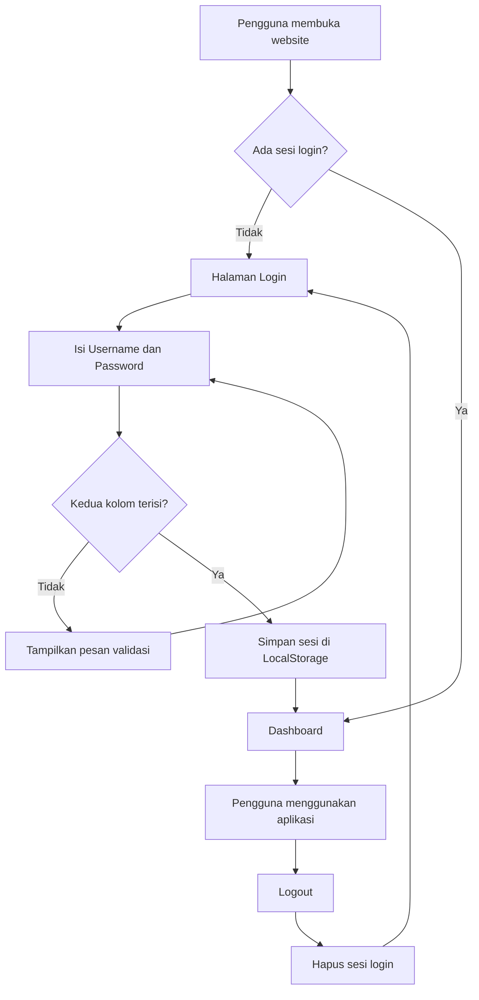
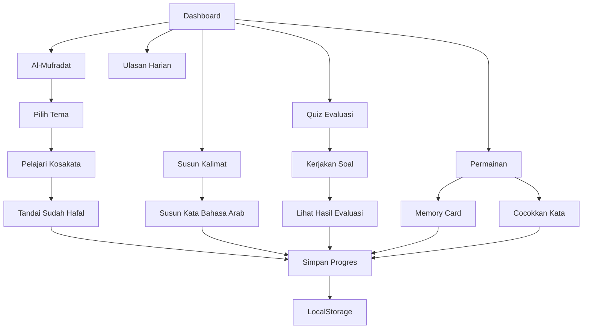

# Rancangan Proyek Al-Mufradat

## Media Pembelajaran Kosakata Bahasa Arab untuk Pemula

## 1. Deskripsi Proyek

Al-Mufradat merupakan aplikasi web pembelajaran kosakata Bahasa Arab untuk pemula. Aplikasi ini membantu pengguna mempelajari, menghafal, melatih pelafalan, dan mengevaluasi pemahaman kosakata Bahasa Arab melalui materi dan permainan edukatif.

Aplikasi akan dikembangkan menggunakan Next.js dan dapat diakses melalui browser setelah di-deploy ke Vercel.

Pengembangan tahap pertama tidak menggunakan database. Data materi dan soal disimpan dalam file JSON, sedangkan data pengguna dan progres belajar disimpan menggunakan LocalStorage pada browser.

## 2. Tujuan Aplikasi

1. Membantu pengguna mempelajari kosakata Bahasa Arab berdasarkan tema.
2. Membantu pengguna memahami tulisan Arab berharakat dan tanpa harakat.
3. Melatih pelafalan kosakata menggunakan Text-to-Speech.
4. Melatih kemampuan menyusun kalimat sederhana dalam Bahasa Arab.
5. Mengukur pemahaman pengguna melalui kuis dan permainan.
6. Menyimpan progres pembelajaran secara otomatis di perangkat pengguna.

## 3. Teknologi yang Digunakan

| Teknologi      | Kegunaan                           |
| -------------- | ---------------------------------- |
| Next.js        | Framework pengembangan aplikasi    |
| React          | Membangun komponen antarmuka       |
| JavaScript     | Bahasa pemrograman                 |
| CSS            | Mengatur tampilan aplikasi         |
| JSON           | Menyimpan data kosakata dan soal   |
| LocalStorage   | Menyimpan sesi dan progres belajar |
| Web Speech API | Membacakan kosakata Bahasa Arab    |
| GitHub         | Menyimpan source code              |
| Vercel         | Deployment aplikasi                |

Tidak menggunakan:

- MySQL
- PostgreSQL
- MongoDB
- PHP
- Prisma
- Backend API khusus
- Sistem autentikasi berbasis server

## 4. Sistem Login

### 4.1 Konsep Login

Aplikasi menggunakan sistem login sederhana tanpa database.

Pengguna dapat memasukkan username dan password bebas. Sistem hanya memeriksa apakah kedua kolom sudah diisi.

Contoh:

| Username | Password   | Hasil          |
| -------- | ---------- | -------------- |
| andi     | 12345      | Berhasil masuk |
| budi     | belajar123 | Berhasil masuk |
| siti     | abc123     | Berhasil masuk |

Tidak ada proses registrasi dan tidak ada verifikasi username atau password.

### 4.2 Alur Login

1. Pengguna membuka website.
2. Sistem memeriksa apakah terdapat sesi login di LocalStorage.
3. Jika belum login, pengguna diarahkan ke halaman login.
4. Pengguna mengisi username dan password.
5. Sistem memvalidasi bahwa kedua kolom tidak kosong.
6. Jika valid, pengguna masuk ke halaman dashboard.
7. Sistem menyimpan username dan status sesi di LocalStorage.

### 4.3 Logout

- Pengguna menekan tombol logout.
- Sesi login dihapus.
- Pengguna diarahkan kembali ke halaman login.
- Progres belajar tidak ikut dihapus.

**Catatan keamanan:** Login ini hanya gerbang masuk tampilan, bukan autentikasi sungguhan. Password tidak perlu disimpan. Pengguna lain tetap dapat masuk menggunakan username yang sama.

## 5. Dashboard

Dashboard merupakan halaman utama setelah pengguna berhasil masuk.

### Informasi yang Ditampilkan

- Sapaan berdasarkan username.
- Jumlah kosakata yang sudah dihafal.
- Streak belajar harian.
- Skor terbaik kuis.
- Kosakata pilihan hari ini.
- Jumlah kosakata yang perlu diulang.

### Menu Utama

1. Al-Mufradat
2. Susun Kalimat
3. Quiz Evaluasi
4. Permainan

Dashboard juga menyediakan akses ke materi, ulasan harian, dan panduan aplikasi.

## 6. Modul Materi Al-Mufradat

Modul ini berisi kumpulan kosakata Bahasa Arab yang dibagi menjadi 10 tema.

### 6.1 Daftar Tema

1. Keluarga
2. Angka
3. Sekolah
4. Warna
5. Tubuh
6. Rumah
7. Hewan
8. Makanan
9. Alam
10. Kata Kerja

### 6.2 Informasi Kosakata

Setiap kosakata dapat memiliki informasi:

- Tulisan Bahasa Arab.
- Harakat.
- Cara baca Latin.
- Arti dalam Bahasa Indonesia.
- Tema kosakata.
- Jenis kata atau gender jika tersedia pada data sumber.

### 6.3 Fitur Materi

- Menampilkan daftar tema.
- Menampilkan kosakata berdasarkan tema.
- Pencarian kosakata.
- Tampilan grid dan daftar.
- Menampilkan atau menyembunyikan informasi pelafalan.
- Menandai kosakata sebagai sudah dihafal.
- Menampilkan jumlah kosakata yang sudah dihafal.

### 6.4 Tingkat Kesulitan

| Tingkat | Ketentuan                                                                                  |
| ------- | ------------------------------------------------------------------------------------------ |
| Mudah   | Harakat dan cara baca Latin ditampilkan.                                                   |
| Sedang  | Harakat ditampilkan, cara baca Latin disembunyikan secara default.                         |
| Sulit   | Tulisan Arab ditampilkan tanpa harakat dan pengguna dapat menggunakan fitur Intip Harakat. |

## 7. Modul Text-to-Speech

Fitur ini digunakan untuk membacakan kosakata Bahasa Arab.

Fungsi:

- Membacakan kosakata.
- Membacakan kosakata pilihan hari ini.
- Membacakan kalimat latihan.
- Membacakan pertanyaan kuis.

Teknologi yang digunakan adalah Web Speech API melalui SpeechSynthesis.

Catatan: ketersediaan suara Bahasa Arab bergantung pada browser dan suara yang terpasang di perangkat pengguna.

## 8. Modul Susun Kalimat

Modul ini membantu pengguna menyusun kalimat sederhana Bahasa Arab.

### Fitur

- Menampilkan arti kalimat dalam Bahasa Indonesia.
- Menampilkan kumpulan kata Bahasa Arab secara acak.
- Pengguna memilih kata untuk menyusun kalimat.
- Pengguna dapat menghapus kata dari susunan.
- Pengguna memeriksa jawaban.
- Sistem menampilkan hasil benar atau salah.
- Menampilkan penjelasan sederhana mengenai susunan kalimat.

### Tingkat Kesulitan

| Tingkat | Ketentuan                                               |
| ------- | ------------------------------------------------------- |
| Mudah   | Kalimat terdiri dari 2 kata.                            |
| Sedang  | Kalimat terdiri dari 2–3 kata.                         |
| Sulit   | Kalimat terdiri dari 3 kata dan memiliki kata pengecoh. |

Penyusunan kata Bahasa Arab mengikuti arah kanan ke kiri (RTL).

## 9. Modul Quiz Evaluasi

Modul kuis digunakan untuk mengukur pemahaman pengguna terhadap kosakata.

### Fitur

- Pilihan jumlah soal 10–100 soal.
- Pertanyaan kosakata Bahasa Arab.
- Pilihan jawaban.
- Indikator progres pengerjaan.
- Penghitungan jawaban benar dan salah.
- Timer berdasarkan tingkat kesulitan.
- Hasil evaluasi setelah kuis selesai.

### Ketentuan Timer

| Tingkat | Timer             |
| ------- | ----------------- |
| Mudah   | Tanpa batas waktu |
| Sedang  | 20 detik per soal |
| Sulit   | 12 detik per soal |

### Hasil Evaluasi

Menampilkan:

- Skor akhir.
- Jumlah jawaban benar.
- Jumlah jawaban salah.
- Tingkat kesulitan.
- Kosakata yang perlu diulang.
- Tombol mengulangi kuis.
- Tombol kembali ke dashboard.

Skor terbaik disimpan di LocalStorage.

## 10. Modul Permainan

Terdapat dua permainan edukatif.

### 10.1 Memory Card

Permainan mencocokkan kartu Bahasa Arab dengan artinya.

Fitur:

- Kartu kosakata Bahasa Arab.
- Kartu arti Bahasa Indonesia.
- Kartu dibalik ketika dipilih.
- Pengguna mencari pasangan yang sesuai.
- Permainan selesai ketika semua pasangan ditemukan.

### 10.2 Cocokkan Kata

Permainan mencocokkan kosakata Bahasa Arab dengan arti Bahasa Indonesia.

Fitur:

- Menampilkan daftar kosakata.
- Menampilkan daftar arti.
- Pengguna memilih pasangan yang sesuai.
- Sistem memeriksa kecocokan.
- Menampilkan hasil permainan.

## 11. Modul Ulasan Harian

Modul ini membantu pengguna mengulang kosakata yang belum dikuasai.

### Fitur

- Menampilkan kosakata yang perlu diulang.
- Menampilkan jadwal pengulangan.
- Menampilkan kosakata yang sudah dikuasai.
- Membantu pengguna mengulang materi secara bertahap.

### Sistem Pengulangan

Menggunakan konsep Spaced Repetition sederhana.

Interval pengulangan yang digunakan:

| Tingkat Penguasaan | Interval |
| ------------------ | -------- |
| Awal               | 0 hari   |
| Tahap 1            | 1 hari   |
| Tahap 2            | 3 hari   |
| Tahap 3            | 7 hari   |
| Tahap 4            | 14 hari  |

Jawaban salah akan mengembalikan tingkat penguasaan kosakata.

## 12. Modul Panduan

Halaman ini berisi petunjuk penggunaan aplikasi.

Isi panduan:

- Deskripsi aplikasi.
- Tujuan pembelajaran.
- Cara menggunakan materi.
- Cara menggunakan Text-to-Speech.
- Penjelasan tingkat kesulitan.
- Cara mengerjakan kuis.
- Cara memainkan permainan.
- Penjelasan penyimpanan progres.

### Pengaturan

- Mengubah tema terang dan gelap.
- Mengunggah foto latar masjid.
- Reset seluruh progres belajar.

Tidak menyediakan fitur edit profil.

## 13. Sistem Penyimpanan Data

Aplikasi tidak menggunakan database.

Penyimpanan dibagi menjadi dua bagian.

### 13.1 File JSON

Digunakan untuk menyimpan data yang sudah disediakan oleh pengembang.

Contoh:

- Data kosakata.
- Daftar tema.
- Pertanyaan kuis.
- Soal susun kalimat.
- Data permainan.

### 13.2 LocalStorage

Digunakan untuk menyimpan data pengguna di browser.

Contoh:

- Username sesi aktif.
- Status login.
- Tingkat kesulitan.
- Kosakata yang sudah dihafal.
- Riwayat pengulangan.
- Streak harian.
- Skor terbaik.
- Tema tampilan.
- Foto latar masjid.

### 13.3 Pembagian Penyimpanan

| Data                | Tempat Penyimpanan |
| ------------------- | ------------------ |
| Kosakata            | JSON               |
| Tema kosakata       | JSON               |
| Soal kuis           | JSON               |
| Soal susun kalimat  | JSON               |
| Username sesi       | LocalStorage       |
| Status login        | LocalStorage       |
| Progres belajar     | LocalStorage       |
| Skor kuis           | LocalStorage       |
| Streak              | LocalStorage       |
| Pengaturan tampilan | LocalStorage       |

### 13.4 Struktur Key LocalStorage

Contoh rancangan:

```javascript
almufradat_session
almufradat_user_andi
almufradat_theme
```

Data progres dapat dipisahkan berdasarkan username pada browser yang sama.

Password tidak disimpan.

Catatan:

- LocalStorage hanya tersedia pada browser dan perangkat tempat data disimpan.
- Data tidak otomatis tersinkronisasi ke perangkat lain.
- Menghapus data browser dapat menghapus progres belajar.
- Username bukan identitas yang terverifikasi. Pengguna lain dapat memakai username yang sama untuk membuka data lokal dengan nama tersebut.

## 14. Struktur Halaman (Routing)

| URL                   | Halaman                |
| --------------------- | ---------------------- |
| `/login`            | Login                  |
| `/`                 | Dashboard              |
| `/materi`           | Daftar tema dan materi |
| `/latihan`          | Menu latihan           |
| `/latihan/kuis`     | Kuis evaluasi          |
| `/latihan/hasil`    | Hasil kuis             |
| `/latihan/kalimat`  | Susun kalimat          |
| `/latihan/memory`   | Memory card            |
| `/latihan/cocokkan` | Cocokkan kata          |
| `/ulasan`           | Ulasan harian          |
| `/panduan`          | Panduan dan pengaturan |

Halaman selain login harus memeriksa sesi login di sisi client.

## 15. Struktur Folder Next.js

```text
al-mufradat/
│
├── public/
│   ├── images/
│   ├── icons/
│   └── fonts/
│
├── src/
│   ├── app/
│   │   ├── layout.js
│   │   ├── page.js
│   │   ├── globals.css
│   │   │
│   │   ├── login/
│   │   │   └── page.js
│   │   │
│   │   ├── materi/
│   │   │   └── page.js
│   │   │
│   │   ├── latihan/
│   │   │   ├── page.js
│   │   │   ├── kuis/
│   │   │   │   └── page.js
│   │   │   ├── hasil/
│   │   │   │   └── page.js
│   │   │   ├── kalimat/
│   │   │   │   └── page.js
│   │   │   ├── memory/
│   │   │   │   └── page.js
│   │   │   └── cocokkan/
│   │   │       └── page.js
│   │   │
│   │   ├── ulasan/
│   │   │   └── page.js
│   │   │
│   │   └── panduan/
│   │       └── page.js
│   │
│   ├── components/
│   │   ├── layout/
│   │   │   ├── Navbar.js
│   │   │   ├── BottomNavigation.js
│   │   │   └── AppShell.js
│   │   │
│   │   ├── login/
│   │   │   └── LoginForm.js
│   │   │
│   │   ├── home/
│   │   │   ├── Dashboard.js
│   │   │   ├── CategoryCard.js
│   │   │   ├── ProgressCard.js
│   │   │   └── DailyVocabulary.js
│   │   │
│   │   ├── materi/
│   │   │   ├── ThemeList.js
│   │   │   ├── VocabularyCard.js
│   │   │   ├── VocabularyList.js
│   │   │   ├── VocabularySearch.js
│   │   │   └── DifficultySelector.js
│   │   │
│   │   ├── latihan/
│   │   │   ├── QuizCard.js
│   │   │   ├── QuizResult.js
│   │   │   ├── MemoryCard.js
│   │   │   ├── MatchGame.js
│   │   │   └── SentenceBuilder.js
│   │   │
│   │   └── common/
│   │       ├── Button.js
│   │       ├── Modal.js
│   │       └── ThemeToggle.js
│   │
│   ├── data/
│   │   ├── vocabulary.json
│   │   ├── themes.js
│   │   ├── quiz.json
│   │   └── sentences.json
│   │
│   ├── hooks/
│   │   ├── useSession.js
│   │   ├── useProgress.js
│   │   └── useTheme.js
│   │
│   └── utils/
│       ├── storage.js
│       ├── speech.js
│       ├── date.js
│       └── scoring.js
│
├── package.json
├── next.config.js
└── README.md
```

## 16. Alur Sistem Aplikasi

### 16.1 Alur Login



### 16.2 Alur Pembelajaran



## 17. Tahapan Pengembangan

### Tahap 1 — Persiapan

- Membuat proyek Next.js.
- Mengatur struktur folder.
- Mengatur CSS global.
- Menyiapkan data JSON.

### Tahap 2 — Sistem Login

- Membuat halaman login.
- Membuat validasi username dan password.
- Membuat penyimpanan sesi.
- Membuat fungsi logout.

### Tahap 3 — Layout dan Navigasi

- Membuat Navbar.
- Membuat navigasi bawah.
- Membuat layout utama.
- Membuat tema terang dan gelap.

### Tahap 4 — Dashboard

- Membuat tampilan dashboard.
- Menampilkan progres belajar.
- Menampilkan streak.
- Menampilkan kosakata pilihan hari ini.

### Tahap 5 — Materi

- Membuat daftar 10 tema.
- Membuat kartu kosakata.
- Membuat pencarian.
- Membuat tingkat kesulitan.
- Membuat fitur Text-to-Speech.
- Membuat penanda hafalan.

### Tahap 6 — Latihan

- Membuat susun kalimat.
- Membuat kuis evaluasi.
- Membuat hasil evaluasi.
- Membuat Memory Card.
- Membuat permainan Cocokkan Kata.

### Tahap 7 — Progres Belajar

- Membuat LocalStorage.
- Menyimpan skor.
- Menyimpan streak.
- Membuat ulasan harian.
- Membuat Spaced Repetition.

### Tahap 8 — Panduan dan Pengaturan

- Membuat halaman panduan.
- Membuat pengaturan tampilan.
- Membuat unggah foto latar.
- Membuat reset progres.

### Tahap 9 — Pengujian

- Menguji login dan logout.
- Menguji seluruh halaman.
- Menguji penyimpanan LocalStorage.
- Menguji fitur pembelajaran.
- Menguji tampilan desktop dan mobile.
- Menguji refresh halaman.

### Tahap 10 — Deployment

- Mengunggah source code ke GitHub.
- Menghubungkan repository ke Vercel.
- Melakukan deployment.
- Menguji aplikasi melalui domain Vercel.

## 18. Batasan Sistem

1. Aplikasi tidak menggunakan database.
2. Aplikasi tidak menggunakan backend khusus.
3. Login tidak melakukan verifikasi identitas pengguna.
4. Tidak ada registrasi akun.
5. Tidak ada fitur edit profil.
6. Data progres hanya tersimpan pada browser dan perangkat pengguna.
7. Progres tidak dapat disinkronisasi antarperangkat.
8. Data materi dan soal dikelola melalui file JSON.
9. Jika data browser dihapus, progres lokal dapat hilang.
10. Fitur Text-to-Speech bergantung pada dukungan browser.

## 19. Kriteria Keberhasilan

Aplikasi dianggap berhasil apabila:

- Pengguna dapat masuk dengan username dan password yang tidak kosong.
- Pengguna dapat mengakses dashboard.
- Semua 10 tema kosakata dapat dibuka.
- Pengguna dapat mencari dan mempelajari kosakata.
- Fitur suara dapat digunakan jika didukung perangkat.
- Pengguna dapat mengerjakan latihan dan permainan.
- Hasil kuis dapat ditampilkan.
- Progres belajar tersimpan setelah halaman di-refresh.
- Pengguna dapat logout tanpa menghapus progres.
- Aplikasi dapat diakses melalui deployment Vercel.

## 20. Kesimpulan

Al-Mufradat akan dikembangkan sebagai aplikasi pembelajaran Bahasa Arab berbasis Next.js tanpa database.

File JSON digunakan sebagai sumber data materi, sedangkan LocalStorage digunakan untuk menyimpan sesi login dan progres belajar pada perangkat pengguna.

Pendekatan ini membuat aplikasi lebih sederhana untuk dikembangkan dan di-deploy ke Vercel, serta tidak membutuhkan pengelolaan server database pada tahap pertama.
